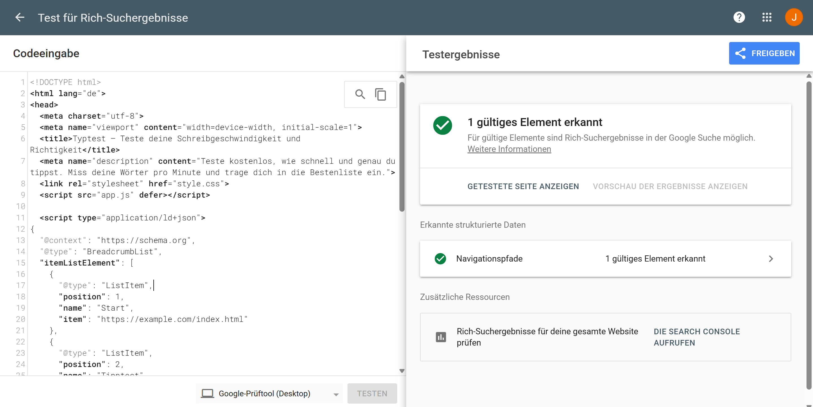

# TypeTesting

Ein bis zwei Sätze: Man kann seine Wörter pro Minute testen. Mit lokalem Leaderboard

**Live:** noch nicht festgelegt
**Team:** Julius Strobel, Thilo Esch

## Was die App kann

- Wörter pro Minute messen
- Lokales Leaderboard

## Datenquelle

- Quotes API

## Lokal starten

In VS Code mit Live Server öffnen – oder:

```bash
npx serve .
```

## Technik

Womit gebaut und warum. Eine Zeile pro Entscheidung reicht, aber es soll eine Entscheidung sein, keine Aufzählung von Buzzwords.

## KI-Log

Ehrlich ausfüllen, das zählt zur Bewertung.

| Werkzeug      | Wofür benutzt                              |
| ------------- | ------------------------------------------ |
| z. B. Copilot | z. B. Formular-Validierung erklären lassen |

**Ein Fall, in dem KI geholfen hat:** Was habt ihr gefragt, was kam zurück, was habt ihr geändert?

**Ein Fall, in dem KI falsch lag:** Woran habt ihr es gemerkt, wie habt ihr es gelöst?

## Aufgaben

### WE1_Blatt02_Das-Gerüst



### Kollision

**Kollision**

- Regeln: Die erste Regel für die Hintergrundfarbe des Headers und die zweite Regel für die Hintergrundfarbe des Headers treffen auf dasselbe Element zu.
- Gewinner: Die zweite Regel gewinnt (die später in der css Datei)
- Warum: Beide Regeln haben exakt dieselbe Spezifität, weshalb die Kaskade greift und die weiter unten in der Datei stehende Regel gewinnt. Die alte gespeicherte Anweisung wird überschrieben und durch die nachfolgende ausgetauscht (chronlogische vorgehensweise)

## UI-Komponenten (A3)

Für ein konsistentes Designsystem wurden folgende drei wiederkehrenden Komponenten mit Tailwind CSS umgesetzt:

1. **Karten (Cards)**
   - Vorkommen: Statistik-Sektion (`WPM`, `Genauigkeit`, `Fehler`) in `tipptest.html`
   - Styling: `p-4 rounded-xl border border-black/10 bg-white`

2. **Eingabefelder (Inputs)**
   - Vorkommen: Zentrales Textfeld für den Tipptest
   - Styling: `w-full p-4 rounded-xl border border-black/10 bg-white`

3. **Buttons (Schaltflächen)**
   - Vorkommen: Startelement
   - Styling: `px-5 py-2.5 rounded-xl border border-black/10 text-center font-bold bg-white`
